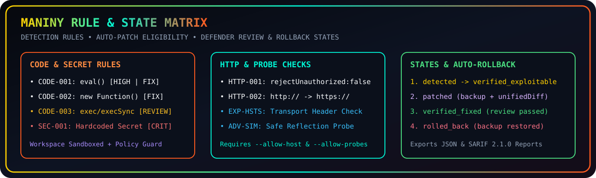

 

---

## Pipeline Architecture

- **Detector (`src/stages/detector.ts`):** Scans workspace files and queues allowed URLs while skipping `node_modules`, `.git`, build folders, and MANINY report files.
- **Safe Verifier & Exposure (`src/stages/verifier.ts`, `src/stages/exposure-checker.ts`):** Performs static pattern verification and checks security headers and `HSTS` on authorized targets.
- **Adversarial Simulation (`src/stages/adversarial-sim.ts`):** Runs benign reflection checks only when `--allow-probes` is set and the host matches `--allow-host`.
- **Fixer & Defender Reviewer (`src/stages/fixer.ts`, `src/stages/reviewer.ts`):** Enforces workspace containment and policy guards, stores backup content + `unifiedDiff`, and automatically restores the backup (`rolled_back`) if review fails.

---

## Rules & Rollback Matrix

| Rule ID | Category | Severity | Target | Auto-Fix |
| :--- | :--- | :--- | :--- | :--- |
| `MANINY-CODE-001` | `code-pattern` | `high` | `eval()` | Yes |
| `MANINY-CODE-002` | `code-pattern` | `high` | `new Function()` | Yes |
| `MANINY-CODE-003` | `code-pattern` | `high` | `exec()` / `execSync()` | Manual review |
| `MANINY-HTTP-001` | `http-hardening` | `medium` | `rejectUnauthorized: false` | Yes |
| `MANINY-HTTP-002` | `http-hardening` | `medium` | Non-local `http://` | Yes (`https://`) |
| `MANINY-SEC-001` | `secret-exposure` | `critical` | Hardcoded secret literals | Manual review |

---

## Build & Run

Build with `npm install && npm run build`, then run `node ./dist/cli.js --mode pipeline --workspace ./sample-target --allow-fix --format both --report ./maniny-report`.
