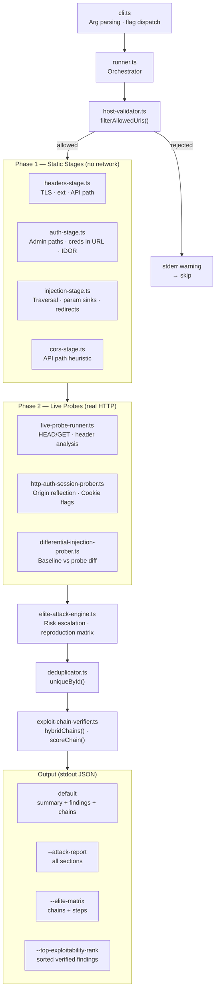
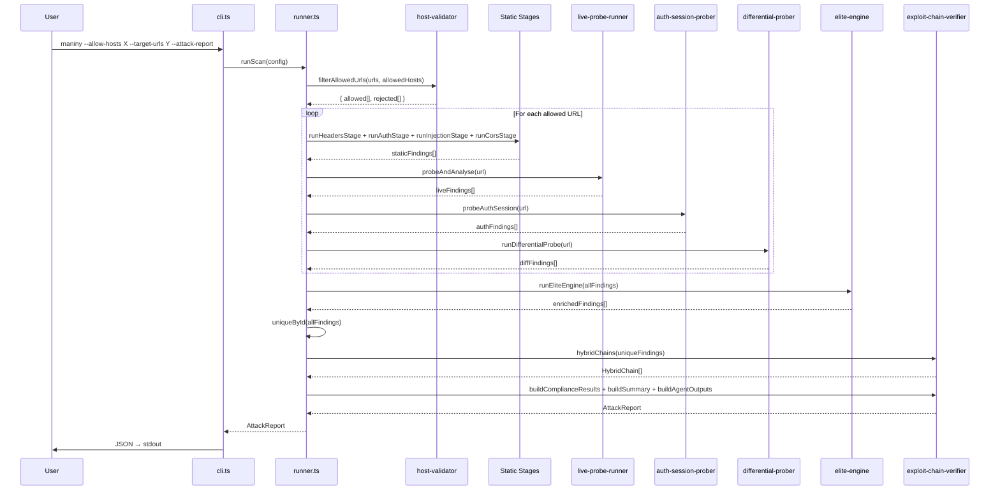
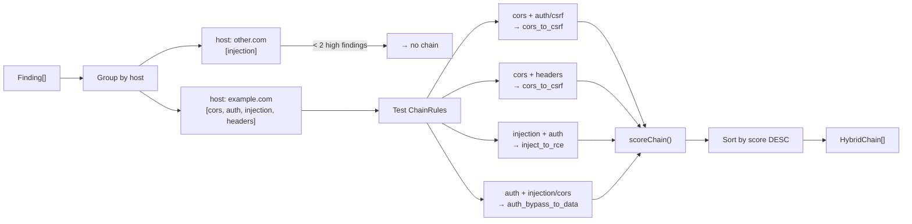

<p align="center">
  
</p>

<p align="center">
  
  
  
  
  
  
</p>

<br/>

> **MANINY DIGITAL** is a CLI security scanner, hybrid chain correlator, and multi-agent JSON output tool built in TypeScript.  
> It runs cleanly in Node.js ≥ 20 — including lightweight mobile/Termux environments — with **zero runtime dependencies**.

---

## Table of Contents

- [Features](#features)
- [Architecture](#architecture)
- [Module Reference](#module-reference)
- [Installation](#installation)
- [Usage](#usage)
  - [CLI Flags](#cli-flags)
  - [Default Output](#default-output)
  - [--attack-report](#--attack-report)
  - [--elite-matrix](#--elite-matrix)
  - [--top-exploitability-rank](#--top-exploitability-rank)
- [How hybridChains Works](#how-hybridchains-works)
- [Scoring Algorithm](#scoring-algorithm)
- [Test Suite](#test-suite)
- [Termux Quick Start](#termux-quick-start)
- [Responsible Use](#responsible-use)
- [License](#license)

---

## Features

| Feature | Description |
|---------|-------------|
| 🔒 **Allow-host boundary** | Strict `--allow-hosts` gate — no URL is probed unless its host is explicitly on the list |
| ⛓ **Hybrid chain correlation** | `hybridChains()` groups findings by host and detects cross-finding attack paths |
| 🧬 **Differential injection** | Baseline vs. probe comparison (SQL, XSS, path traversal, open redirect) |
| 🔬 **Live HTTP probe** | HEAD/GET probe + security-header analysis via Node.js built-ins |
| 🍪 **Auth/CORS prober** | Reflects crafted `Origin` headers, checks `Set-Cookie` attributes |
| ⚙️ **Elite attack engine** | Risk escalation + automatic reproduction-step enrichment |
| 📋 **OWASP compliance** | Maps all findings to OWASP Top 10 2021 controls |
| 🤖 **Multi-agent JSON** | Per-role agent output (static, live, differential, elite) |
| 📦 **Zero runtime deps** | Only `typescript` + `@types/node` as devDependencies |
| 📱 **Termux-ready** | Pure Node.js built-ins — works on Android without native modules |

---

## Architecture



---

### Scan lifecycle (sequence)



---

## Module Reference

### `src/types.ts` — Shared types

| Type | Description |
|------|-------------|
| `Finding` | Core finding model with id, host, severity, exploitability (0–100), reproductionSteps |
| `HybridChain` | Correlated attack chain: chainType, score (0–100), findings[], impact |
| `AttackReport` | Top-level output: summary, findings, hybridChains, agents, compliance |
| `ScanConfig` | Runtime config from CLI args |
| `ChainType` | `cors_to_csrf` · `inject_to_rce` · `auth_bypass_to_data` · `mixed` |
| `Severity` | `critical` · `high` · `medium` · `low` · `info` |

---

### `src/utils/`

| File | Exports | Purpose |
|------|---------|---------|
| `host-validator.ts` | `isHostAllowed`, `filterAllowedUrls`, `parseAllowedHosts` | Allow-host boundary — deny by default |
| `deduplicator.ts` | `uniqueById`, `generateFindingId`, `generateScanId` | DJB2-XOR deterministic IDs; O(n) dedup |
| `http-client.ts` | `fetchUrl` | Async HTTP/HTTPS via Node.js built-ins; timeout + redirect |
| `json-output.ts` | `printJson`, `warn`, `errorOut`, `formatDefault`, `formatAttackReport`, `formatTopRank`, `formatEliteMatrix` | stdout-only JSON; stderr-only warnings |

---

### `src/core/`

| File | Exports | Purpose |
|------|---------|---------|
| `live-probe-runner.ts` | `runLiveProbe`, `analyseLiveProbe`, `probeAndAnalyse` | HEAD/GET probe + response-header analysis |
| `http-auth-session-prober.ts` | `probeAuthSession` | CORS Origin reflection + Set-Cookie attribute checks |
| `differential-injection-prober.ts` | `runDifferentialProbe` | SQL · XSS · traversal · redirect differential |
| `elite-attack-engine.ts` | `runEliteEngine`, `buildReproductionMatrix` | Risk escalation via typed `RiskMethod` rules |
| `exploit-chain-verifier.ts` | `hybridChains`, `scoreChain`, `buildComplianceResults`, `buildAgentOutputs`, `buildTopExploitabilityRank`, `buildSummary` | Core chain logic — primary test target |

---

### `src/stages/`

| File | Static detection |
|------|-----------------|
| `headers-stage.ts` | Plaintext HTTP, sensitive file extensions (`.bak`, `.env`, `.sql`…), API path heuristic |
| `auth-stage.ts` | Admin/panel paths, credentials in query string, IDOR patterns |
| `injection-stage.ts` | Path traversal sequences, injection-prone parameters, open-redirect params |
| `cors-stage.ts` | API path heuristic (pre-live), CORS header analysis (post-live) |

All static stages run with **no network access**; they produce `potential` findings that live stages then confirm or discard.

---

## Installation

```bash
# Clone
git clone https://github.com/lamin-16/MANINY.git
cd MANINY

# Install devDeps (TypeScript + @types/node only)
npm install

# Build
npm run build

# Verify (54 tests)
npm test
```

> **Termux:** See [Termux Quick Start](#termux-quick-start) below.

---

## Usage

### CLI Flags

```
Usage:
  maniny --allow-hosts <hosts> --target-urls <urls> [flags]

Required:
  --allow-hosts <hosts>          Comma-separated allow-list of target hostnames.
                                 Wildcards: *.example.com   Catch-all: *
  --target-urls <urls>           Comma-separated list of target URLs to scan.

Output flags (mutually exclusive; default if none: summary + findings + chains):
  --attack-report                Full JSON attack report (all sections).
  --top-exploitability-rank      Sorted verified findings by exploitability score.
  --elite-matrix                 Hybrid exploit chains with reproduction steps.

Options:
  --timeout <ms>                 HTTP timeout in milliseconds (default: 7000).
  -h, --help                     Print usage.
```

---

### Default Output

```bash
maniny \
  --allow-hosts "example.com" \
  --target-urls "http://example.com/admin?id=1&token=xyz,https://example.com/api/v1/users"
```

```json
{
  "scanId": "scan-mwwxd3f1-k9z2m",
  "timestamp": "2026-11-26T02:20:33.015Z",
  "version": "0.2.0",
  "target": {
    "hosts": ["example.com"],
    "urls": ["http://example.com/admin?id=1&token=xyz", "https://example.com/api/v1/users"]
  },
  "summary": {
    "total": 11,
    "critical": 2,
    "high": 5,
    "medium": 2,
    "low": 2,
    "info": 0,
    "verified": 0,
    "chains": 4
  },
  "findings": [ ... ],
  "hybridChains": [ ... ]
}
```

---

### `--attack-report`

```bash
maniny \
  --allow-hosts "*.example.com" \
  --target-urls "https://api.example.com/v1/users" \
  --attack-report
```

Includes every section: `findings`, `hybridChains`, `topExploitabilityRank`, `agents`, `compliance`.

```json
{
  "compliance": [
    { "framework": "OWASP Top 10 2021", "control": "A01:2021 Broken Access Control",    "status": "fail",    "relatedFindingIds": ["finding-b4d02dfc"] },
    { "framework": "OWASP Top 10 2021", "control": "A03:2021 Injection",                 "status": "partial", "relatedFindingIds": ["finding-c9e1a3bb"] },
    { "framework": "OWASP Top 10 2021", "control": "A05:2021 Security Misconfiguration", "status": "fail",    "relatedFindingIds": ["finding-7a2d11e0", "finding-c166f71a"] }
  ],
  "agents": [
    { "agentId": "agent-static-01", "role": "Static Analysis Agent",       "findings": [...], "chainIds": [] },
    { "agentId": "agent-elite-01",  "role": "Elite Verification Agent",    "findings": [...], "chainIds": ["chain-..."] }
  ]
}
```

---

### `--elite-matrix`

```bash
maniny \
  --allow-hosts "example.com" \
  --target-urls "https://example.com/api,https://example.com/admin" \
  --elite-matrix
```

```json
[
  {
    "id": "chain-finding-3c8a1d02",
    "host": "example.com",
    "title": "CORS Misconfiguration → CSRF / Session Hijack Chain",
    "chainType": "cors_to_csrf",
    "score": 100,
    "reproductionSteps": [
      "Confirm CORS arbitrary-origin reflection (see CORS finding).",
      "Identify an authenticated action endpoint (see auth finding).",
      "Host a page at the attacker origin that makes a credentialed cross-origin request.",
      "On victim visit, the victim's cookies are sent and the response is readable."
    ],
    "impact": "An attacker on any domain can forge credentialed requests as an authenticated victim...",
    "findings": [ ... ]
  }
]
```

---

### `--top-exploitability-rank`

```bash
maniny \
  --allow-hosts "example.com" \
  --target-urls "https://example.com/api/v1" \
  --top-exploitability-rank
```

Returns a JSON array of verified findings sorted by `exploitability` descending (max 20 entries).

---

## How `hybridChains` Works



**Chain type detection rules:**

| Chain type | Category group A | Category group B |
|------------|-----------------|-----------------|
| `cors_to_csrf` | `cors` | `auth`, `csrf` |
| `cors_to_csrf` | `cors` | `headers`, `auth` |
| `inject_to_rce` | `injection` | `injection`, `auth` |
| `auth_bypass_to_data` | `auth` | `injection`, `cors`, `headers` |
| `mixed` | *(fallback)* | ≥2 critical/high findings on same host |

---

## Scoring Algorithm

```
score = anchor + Σ( additionalᵢ × decay^i ) + chainBonus

Where:
  anchor     = highest exploitability finding in chain
  decay      = 0.25 per additional finding (diminishing returns)
  chainBonus = 10 for specific chain types / 0 for 'mixed'
  cap        = 100
```

**Example:**

| Findings | anchor | +add₁×0.25 | chainBonus | raw | score |
|----------|--------|------------|------------|-----|-------|
| `[90, 70]` cors_to_csrf | 90 | +17.5 | +10 | 117.5 | **100** |
| `[70, 50]` cors_to_csrf | 70 | +12.5 | +10 | 92.5  | **93** |
| `[80]` mixed | 80 | — | 0 | 80 | **80** |
| `[]` | — | — | — | — | **0** |

---

## Test Suite

Run with:

```bash
npm test
# = npm run build && node scripts/smoke-test.mjs && node scripts/test-hybrid-chains.mjs
```

```
── Suite 1: Utility imports ──
  ✓  uniqueById removes duplicates
  ✓  uniqueById preserves order
  ✓  uniqueById handles empty array
  ✓  generateFindingId is deterministic
  ✓  generateFindingId differs on different inputs
  ✓  generateScanId returns non-empty string

── Suite 2: Host validator ──
  ✓  isHostAllowed — exact match
  ✓  isHostAllowed — subdomain wildcard
  ✓  isHostAllowed — wildcard matches apex
  ✓  isHostAllowed — denied when no match
  ✓  isHostAllowed — empty allow list denies all
  ✓  isHostAllowed — catch-all *
  ✓  filterAllowedUrls partitions correctly
  ✓  parseAllowedHosts splits and trims

── Suite 3: CLI output shape ──
  ✓  CLI --help exits cleanly and prints usage
  ✓  CLI default output is valid JSON with expected keys
  ✓  CLI --attack-report includes all report sections
  ✓  CLI --top-exploitability-rank returns an array
  ✓  CLI --elite-matrix returns an array
  ✓  CLI summary has correct numeric fields
  ✓  CLI rejects denied hosts (empty findings)

── Suite 4: Static stage shapes ──
  ✓  runHeadersStage flags plain HTTP
  ✓  runHeadersStage flags .bak extension
  ✓  runAuthStage flags admin path
  ✓  runAuthStage flags token in query string
  ✓  runInjectionStage flags id parameter
  ✓  runCorsStage flags /api/ path
  ✓  All findings have required fields

── hybridChains basic behaviour ──
  ✓  empty input returns empty array
  ✓  single finding produces no chain (needs >=2)
  ✓  two unrelated findings on same host → mixed chain
  ✓  findings on different hosts do NOT chain together

── hybridChains chain type detection ──
  ✓  cors + auth finding → cors_to_csrf chain
  ✓  cors + headers finding → cors_to_csrf chain
  ✓  injection + auth finding → inject_to_rce chain
  ✓  auth + injection → auth_bypass_to_data chain

── Chain structure validation ──
  ✓  chain has all required fields
  ✓  chain.score is 0–100
  ✓  chains are sorted by score descending
  ✓  chain findings include at least one from each matched category group

── scoreChain ──
  ✓  scoreChain empty findings → 0
  ✓  scoreChain single finding → score = exploitability + chainBonus
  ✓  scoreChain mixed chain → no bonus
  ✓  scoreChain caps at 100
  ✓  scoreChain with multiple findings adds diminishing returns
  ✓  scoreChain with high anchor + bonus correctly rounds

── buildComplianceResults ──
  ✓  no findings → all controls pass
  ✓  critical injection finding fails A03
  ✓  cors finding affects A05 control
  ✓  all compliance entries have required fields

── buildSummary ──
  ✓  buildSummary counts correct totals
  ✓  buildSummary with no findings returns zeros

── uniqueById + hybridChains integration ──
  ✓  duplicate findings are deduplicated before chain analysis
  ✓  hybridChains does not produce duplicate chain IDs

── Results: 54 passed, 0 failed ──
```

---

## Termux Quick Start

```bash
# 1. Install Node.js (once)
pkg update && pkg install nodejs

# 2. Grant storage access (once)
termux-setup-storage

# 3. Copy the zip from Downloads
cp ~/storage/downloads/MANINY-v0.2.0.zip ~/
cd ~ && unzip MANINY-v0.2.0.zip && cd MANINY

# 4. Install devDeps and build
npm install && npm run build

# 5. Run tests
npm test

# 6. Use it
node dist/cli.js \
  --allow-hosts "target.example.com" \
  --target-urls "https://target.example.com/api/v1" \
  --attack-report
```

> The `dist/` folder is **pre-compiled and included** in the zip.  
> On Termux you can run `node dist/cli.js` immediately without `npm install` or `npm run build`.

---

## Responsible Use

> **MANINY DIGITAL is an authorised-access-only tool.**

- Run **only** against systems you own or have explicit written permission to test.
- The `--allow-hosts` flag is a hard boundary — the tool enforces it at runtime.
- Differential injection sends non-destructive probe payloads, but always inform the target system owner before running active probes.
- Results are for professional security reporting only. Never use findings to harm systems, extract data, or disrupt services.

---

## License

MIT © 2026 MANINY DIGITAL — see [LICENSE](LICENSE).

---

<p align="center">
  <sub>Built with TypeScript · Runs on Node.js ≥ 20 · Zero runtime dependencies</sub>
</p>
