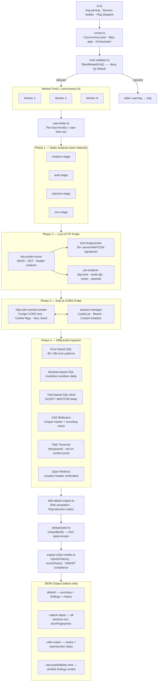
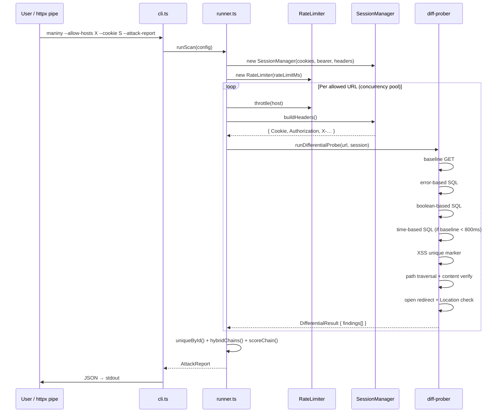
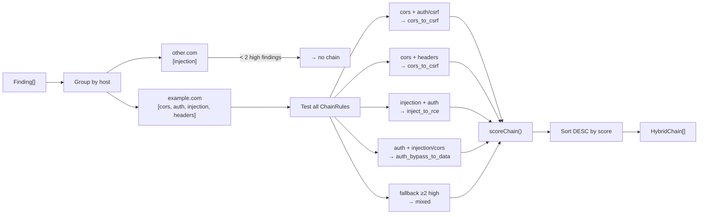

<p align="center">
  
</p>

<p align="center">
  
  
  
  
  
  
  
</p>

<br/>

> **MANINY DIGITAL** is a CLI security scanner, hybrid chain correlator, and multi-agent JSON output tool built in pure TypeScript.  
> Session-aware · WAF-conscious · httpx-compatible · Runs on Node.js ≥ 20 with **zero runtime dependencies**.

---

## Table of Contents

- [What's New in v0.3.0](#whats-new-in-v030)
- [Features](#features)
- [Architecture](#architecture)
- [Module Reference](#module-reference)
- [Installation](#installation)
- [Usage](#usage)
  - [CLI Flags](#cli-flags)
  - [Session & Auth](#session--auth)
  - [httpx Pipeline](#httpx-pipeline)
  - [Output Modes](#output-modes)
- [Detection Engine](#detection-engine)
  - [SQL Injection — 3 Independent Methods](#sql-injection--3-independent-methods)
  - [XSS Reflection](#xss-reflection)
  - [Path Traversal](#path-traversal)
  - [JWT Weakness Analysis](#jwt-weakness-analysis)
  - [Technology Fingerprinting](#technology-fingerprinting)
  - [CORS Multi-Vector Testing](#cors-multi-vector-testing)
- [hybridChains Algorithm](#hybridchains-algorithm)
- [Scoring Formula](#scoring-formula)
- [Test Suite](#test-suite)
- [Termux Quick Start](#termux-quick-start)
- [Responsible Use](#responsible-use)
- [License](#license)

---

## What's New in v0.3.0

| Module | Change |
|--------|--------|
| `differential-injection-prober` | 3-method SQL detection: **error-based**, **boolean-based**, **time-based blind** |
| `differential-injection-prober` | XSS with unique-marker reflection + encoding verification |
| `differential-injection-prober` | Path traversal with `/etc/passwd` / `win.ini` content confirmation |
| `differential-injection-prober` | Open redirect with live `Location:` header verification |
| `session-manager` | Cookie jar, `Bearer` token, custom headers — per-scan, in-memory only |
| `rate-limiter` | Per-host request throttling (configurable, default 300 ms) |
| `tech-fingerprinter` | 30+ server/framework/WAF/CDN signatures from response headers |
| `jwt-analyzer` | `alg:none` bypass, weak algorithm, expired token, sensitive payload claims |
| `http-auth-session-prober` | CORS multi-origin testing (3 origins including `null`) + `Vary: Origin` check |
| `runner` | Concurrency worker pool, httpx NDJSON stdin pipe mode |
| `cli` | 6 new flags: `--cookie`, `--bearer-token`, `--header`, `--rate-limit`, `--concurrency`, `--from-httpx-pipe` |
| `AttackReport` | New `techFingerprints[]` section |
| Tests | **84 tests** across 3 suites (up from 54) |

---

## Features

| Feature | Description |
|---------|-------------|
| 🔒 **Allow-host boundary** | Strict `--allow-hosts` gate — deny by default, no request leaves without explicit approval |
| 🧬 **4-method differential injection** | Error-based, boolean-based, time-based SQL + XSS with unique marker + path traversal with content proof |
| 🔑 **JWT weakness analyzer** | Detects `alg:none` bypass, weak HMAC, expired tokens, sensitive payload data |
| 🌐 **Tech fingerprinter** | 30+ signatures across servers, frameworks, WAFs, CDNs — version disclosure findings |
| 🍪 **Session-aware probing** | Cookie jar, `Bearer` token, custom headers propagated across all probe phases |
| ⛓ **Hybrid chain correlation** | `hybridChains()` groups findings by host into typed, scored attack chains |
| 🌍 **CORS multi-vector** | Tests 3 origin vectors including `null` (sandbox iframe) + `Vary: Origin` check |
| 🤖 **httpx pipeline** | `httpx -l targets.txt -json | maniny --from-httpx-pipe` — fits your existing workflow |
| 🚦 **Rate limiter** | Per-host throttling — polite and WAF-evasion-aware |
| 📋 **OWASP Top 10 2021** | Automatic compliance mapping for all findings |
| 📦 **Zero runtime deps** | Only `typescript` + `@types/node` as devDependencies |
| 📱 **Termux-ready** | Pure Node.js built-ins — works on Android without native modules |

---

## Architecture



---

### Request lifecycle



---

## Module Reference

### New in v0.3.0

| File | Purpose |
|------|---------|
| `src/core/session-manager.ts` | Cookie jar + Bearer token + custom headers. In-memory, never persisted to disk |
| `src/core/rate-limiter.ts` | Per-host request throttle. Polite default: 300 ms. Set to 0 for unrestricted |
| `src/core/tech-fingerprinter.ts` | 30+ tech signatures from headers. Emits version-disclosure and WAF-detected findings |
| `src/core/jwt-analyzer.ts` | Extracts JWTs from headers/body. Checks `alg:none`, weak HMAC, expired, sensitive payload |

### Core modules

| File | Key exports |
|------|-------------|
| `exploit-chain-verifier.ts` | `hybridChains`, `scoreChain`, `buildComplianceResults`, `buildAgentOutputs`, `buildSummary` |
| `differential-injection-prober.ts` | `runDifferentialProbe` — 6 detection methods, every finding is verified with evidence |
| `http-auth-session-prober.ts` | `probeAuthSession` — multi-origin CORS, cookie flags, `Vary` header |
| `live-probe-runner.ts` | `probeAndAnalyse` — session-aware HEAD→GET, tech fingerprint, JWT scan |
| `elite-attack-engine.ts` | `runEliteEngine` — risk escalation via typed `RiskMethod` rules |

### Utilities

| File | Key exports |
|------|-------------|
| `deduplicator.ts` | `uniqueById`, `generateFindingId` (DJB2-XOR, deterministic), `generateScanId` |
| `host-validator.ts` | `isHostAllowed`, `filterAllowedUrls`, `parseAllowedHosts` |
| `http-client.ts` | `fetchUrl` — async HTTP/HTTPS, timeout, redirect, session headers |
| `json-output.ts` | `printJson`, `warn`, `errorOut`, 4 format selectors |

---

## Installation

```bash
git clone https://github.com/lamin-16/MANINY.git
cd MANINY
npm install       # typescript + @types/node only
npm run build     # tsc → dist/
npm test          # 84 tests across 3 suites
```

> **Termux:** See [Termux Quick Start](#termux-quick-start).  
> The `dist/` folder ships pre-compiled — `node dist/cli.js` works immediately.

---

## Usage

### CLI Flags

```
MANINY DIGITAL v0.3.0 — Elite Offensive Security CLI

Usage:
  maniny --allow-hosts <hosts> --target-urls <urls> [flags]
  httpx -l targets.txt -json | maniny --allow-hosts "*.example.com" --from-httpx-pipe --attack-report

Required (or --from-httpx-pipe):
  --allow-hosts <hosts>          Comma-separated allow-list. Wildcards: *.example.com  Catch-all: *
  --target-urls <urls>           Comma-separated list of target URLs.

Output (choose one; default: summary + findings + chains):
  --attack-report                Full JSON report (all sections).
  --top-exploitability-rank      Sorted verified findings by exploitability (max 20).
  --elite-matrix                 Hybrid exploit chains with reproduction steps.

Session / Auth:
  --cookie "name=value"          Session cookie — repeatable, multiple cookies OK.
  --bearer-token <token>         Authorization: Bearer <token>.
  --header "Name: Value"         Custom request header — repeatable.

Performance:
  --concurrency <n>              Parallel URL probes (default: 3, max: 20).
  --rate-limit <ms>              Per-host delay between requests (default: 300).
  --timeout <ms>                 Per-request timeout (default: 7000).

Integration:
  --from-httpx-pipe              Read httpx NDJSON from stdin.

  -h, --help                     Print this help.
```

---

### Session & Auth

```bash
# Cookie-based session
maniny --allow-hosts "app.example.com" \
       --target-urls "https://app.example.com/api/v1/users?id=42" \
       --cookie "session=abc123; csrfToken=xyz789" \
       --attack-report

# Bearer token (API / JWT)
maniny --allow-hosts "api.example.com" \
       --target-urls "https://api.example.com/v2/admin/users" \
       --bearer-token "eyJhbGciOiJIUzI1NiIsInR5cCI6IkpXVCJ9..." \
       --attack-report

# Custom headers + both auth types
maniny --allow-hosts "*.example.com" \
       --target-urls "https://api.example.com/graphql?query=users" \
       --cookie "session=abc" \
       --bearer-token "eyJ..." \
       --header "X-API-Version: 2" \
       --header "X-Client-ID: maniny-audit" \
       --concurrency 5 --rate-limit 200 \
       --attack-report
```

---

### httpx Pipeline

```bash
# Discover live hosts with httpx, pipe directly into MANINY
httpx -l targets.txt -json | \
  maniny --allow-hosts "*.example.com" \
         --from-httpx-pipe \
         --cookie "session=abc123" \
         --attack-report > report.json

# Full recon pipeline
subfinder -d example.com -silent | \
  httpx -json -silent | \
  maniny --allow-hosts "*.example.com" \
         --from-httpx-pipe \
         --elite-matrix
```

---

### Output Modes

#### Default
```bash
maniny --allow-hosts example.com \
       --target-urls "http://example.com/admin?id=1&token=xyz"
```
```json
{
  "scanId":    "scan-mwwxd3f1-k9z2m",
  "timestamp": "2026-11-26T12:00:00.000Z",
  "version":   "0.3.0",
  "summary":   { "total": 10, "critical": 2, "high": 5, "chains": 4 },
  "findings":  [ ... ],
  "hybridChains": [ ... ]
}
```

#### `--attack-report` (full)
```json
{
  "findings":              [ ... ],
  "hybridChains":          [ ... ],
  "topExploitabilityRank": [ ... ],
  "agents":                [ ... ],
  "compliance":            [ ... ],
  "techFingerprints": [
    {
      "host": "example.com",
      "techs": [
        { "name": "Nginx",  "category": "server",  "version": "1.24.0" },
        { "name": "PHP",    "category": "language", "version": "8.2.1" }
      ],
      "wafDetected": false
    }
  ]
}
```

#### `--elite-matrix`
```json
[
  {
    "id":        "chain-finding-3c8a1d02",
    "host":      "example.com",
    "title":     "CORS Misconfiguration → CSRF / Session Hijack Chain",
    "chainType": "cors_to_csrf",
    "score":     100,
    "findings":  [ ... ],
    "reproductionSteps": [
      "Confirm CORS arbitrary-origin reflection (see CORS finding).",
      "Identify an authenticated action endpoint (see auth finding).",
      "Host a page at the attacker origin that makes a credentialed cross-origin request.",
      "On victim visit, the victim's cookies are sent and the response is readable."
    ],
    "impact": "An attacker on any domain can forge credentialed requests as an authenticated victim..."
  }
]
```

---

## Detection Engine

### SQL Injection — 3 Independent Methods

```
Method 1: Error-based  (fastest · highest confidence)
  Payload: '  →  Checks response body for 40+ DB error patterns
  Covered: MySQL · PostgreSQL · MSSQL · Oracle · SQLite · ODBC
  Evidence: Exact SQL error string from the response body
  Status:   verified_exploitable

Method 2: Boolean-based  (behavioral · no error output needed)
  Payload: param=' AND '1'='1  vs  param=' AND '1'='2
  Signal:  TRUE ≈ baseline body length, FALSE body differs > 150 bytes
  Evidence: Body length delta with exact byte counts
  Status:   verified_exploitable

Method 3: Time-based blind  (last resort · works on blind targets)
  Payload: '; SLEEP(3)--  /  '; WAITFOR DELAY '0:0:3'--  /  pg_sleep(3)
  Signal:  responseTime > baseline + 2500ms
  Guard:   Only runs when baseline < 800ms (avoids false positives)
  Evidence: Exact timing delta in milliseconds
  Status:   verified_exploitable
```

### XSS Reflection

```
Marker:   mnn<random 8-char hex>  — unique per parameter per scan
Payloads: <mnnXXXX> · "><mnnXXXX> · '><mnnXXXX> · mnnXXXX">
Check:    Marker appears unencoded in body AND NOT as &lt;mnnXXXX&gt;
Guard:    Content-Type must be text/html or text/plain
Evidence: Exact payload + marker reflected verbatim
Status:   verified_exploitable
```

### Path Traversal

```
Payloads: ../../../etc/passwd · ..%2f..%2f..%2fetc%2fpasswd
          ..%252f..%252fetc%252fpasswd (double-encoded)
          ..\..\..\windows\win.ini · ..%5c..%5cwin.ini

Linux proof:   response body contains 'root:x:0:0'  /  '/bin/bash'
Windows proof: response body contains '[boot loader]'  /  'for 16-bit app'

Status:   verified_exploitable (content-confirmed only)
```

### JWT Weakness Analysis

| Weakness | Severity | Detection |
|----------|----------|-----------|
| `alg: "none"` signature bypass | **Critical** | Header regex match |
| Symmetric algorithm (HS256/384/512) | Medium | Algorithm allow-list |
| Expired token accepted (`exp` elapsed) | **High** | `exp` claim < `Date.now()/1000` |
| Sensitive claim in payload | **High** | Key name pattern match |

JWTs are extracted automatically from:
- `Authorization: Bearer <token>` header
- Any `ey...` pattern embedded in response body

### Technology Fingerprinting

30+ signatures across 5 categories:

| Category | Technologies detected |
|----------|-----------------------|
| Server | Nginx, Apache, IIS, Lighttpd, OpenResty, Caddy, Gunicorn, Kestrel, Tomcat |
| Language | PHP (with version), ASP.NET, Mono |
| Framework | Express.js, Next.js, WordPress, Drupal, Shopify, Joomla, Magento, Laravel, Django |
| CDN | Cloudflare, CloudFront, Fastly, Akamai, Varnish |
| WAF | Sucuri, Imperva/Incapsula, ModSecurity, Fastly WAF, Generic WAF (body patterns) |

**Version disclosure** → `low` severity finding  
**WAF detected** → `info` finding + downstream probes are WAF-aware (time-based SQL disabled)

### CORS Multi-Vector Testing

```
Origin 1: https://evil.maniny-probe.example  — standard attacker origin
Origin 2: null                               — sandbox iframe bypass
Origin 3: https://evil.example.com           — typosquatting variant

For each origin, checks:
  ✓ Access-Control-Allow-Origin reflects the sent origin?
  ✓ Access-Control-Allow-Credentials: true?
  ✓ Vary: Origin present? (cache poisoning risk if absent)

Fully exploitable (critical):  ACAO=attacker-origin + ACAC=true
Wildcard + credentials (high): ACAO=* + ACAC=true
Missing Vary (low):            ACAO set but Vary: Origin absent
```

---

## `hybridChains` Algorithm



**Chain type detection rules:**

| Chain type | Group A | Group B |
|------------|---------|---------|
| `cors_to_csrf` | cors | auth, csrf |
| `cors_to_csrf` | cors | headers, auth |
| `inject_to_rce` | injection | injection, auth |
| `auth_bypass_to_data` | auth | injection, cors, headers |
| `mixed` | *(fallback)* | ≥ 2 critical/high findings on same host |

---

## Scoring Formula

```
score = anchor + Σ( additionalᵢ × 0.25^i ) + chainBonus

  anchor     = highest exploitability finding in chain (0–100)
  decay      = 0.25 per additional finding (diminishing returns)
  chainBonus = +10 for specific chain types / 0 for 'mixed'
  cap        = 100
```

| Findings | anchor | +add₁×0.25 | bonus | raw   | score |
|----------|--------|------------|-------|-------|-------|
| `[90, 70]` cors_to_csrf | 90 | +17.5 | +10 | 117.5 | **100** |
| `[70, 50]` cors_to_csrf | 70 | +12.5 | +10 | 92.5  | **93**  |
| `[80]` mixed             | 80 | —     | 0   | 80    | **80**  |
| `[]`                     | —  | —     | —   | —     | **0**   |

---

## Test Suite

```bash
npm test
# npm run build
# && node scripts/smoke-test.mjs        (28 tests)
# && node scripts/test-hybrid-chains.mjs (26 tests)
# && node scripts/test-new-modules.mjs   (30 tests)
# ─────────────────────────────────────
# Total: 84 tests · 0 failed
```

```
── smoke-test: Utility imports ──      ✓ ×6
── smoke-test: Host validator ──       ✓ ×8
── smoke-test: CLI output shape ──     ✓ ×7
── smoke-test: Static stage shapes ──  ✓ ×7

── hybrid-chains: Basic behaviour ──   ✓ ×4
── hybrid-chains: Type detection ──    ✓ ×4
── hybrid-chains: Structure ──         ✓ ×4
── hybrid-chains: scoreChain ──        ✓ ×6
── hybrid-chains: Compliance ──        ✓ ×4
── hybrid-chains: Summary ──           ✓ ×2
── hybrid-chains: Integration ──       ✓ ×2

── new-modules: SessionManager ──      ✓ ×8
── new-modules: RateLimiter ──         ✓ ×3
── new-modules: TechFingerprinter ──   ✓ ×9
── new-modules: JWT Analyzer ──        ✓ ×7
── new-modules: CLI new flags ──       ✓ ×3

── Results: 84 passed, 0 failed ──
```

---

## Termux Quick Start

```bash
# 1. Install Node.js
pkg update && pkg install nodejs

# 2. Grant storage access
termux-setup-storage

# 3. Extract
cp ~/storage/downloads/MANINY-v0.3.0.zip ~/
cd ~ && unzip MANINY-v0.3.0.zip && cd MANINY

# 4. Install devDeps + build (or skip — dist/ is pre-compiled)
npm install && npm run build

# 5. Test
npm test

# 6. Scan with session
node dist/cli.js \
  --allow-hosts "target.example.com" \
  --target-urls "https://target.example.com/api/v1/users?id=1" \
  --cookie "session=YOUR_SESSION_COOKIE" \
  --bearer-token "YOUR_JWT_TOKEN" \
  --concurrency 2 --rate-limit 500 \
  --attack-report | tee report.json
```

---

## Responsible Use

> **MANINY DIGITAL is an authorised-access-only security tool.**

- Run **only** against systems you own or have **explicit written permission** to test.
- `--allow-hosts` is enforced at runtime — no URL is probed unless its host is on the list.
- Differential injection sends **non-destructive** payloads (no INSERT/UPDATE/DELETE).
- Always notify the target system owner before running active probes.
- Results are for professional security reporting only.

---

## License

MIT © 2026 MANINY DIGITAL — see [LICENSE](LICENSE).

---

<p align="center">
  <sub>
    Built with TypeScript · Zero runtime deps · Node.js ≥ 20 · Termux-ready<br/>
    SQL injection · XSS · Path traversal · JWT analysis · CORS · Tech fingerprinting · Hybrid chain correlation
  </sub>
</p>
